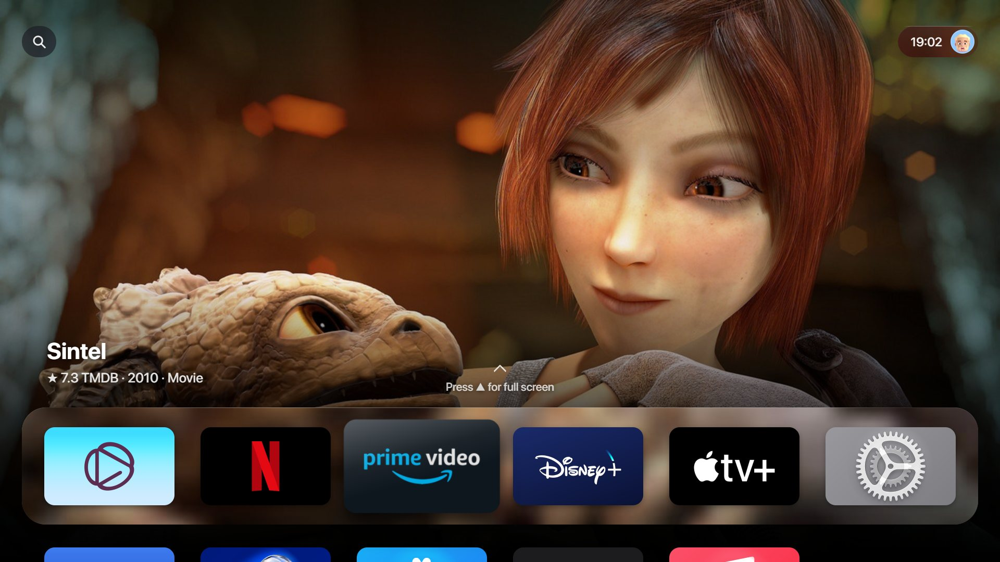
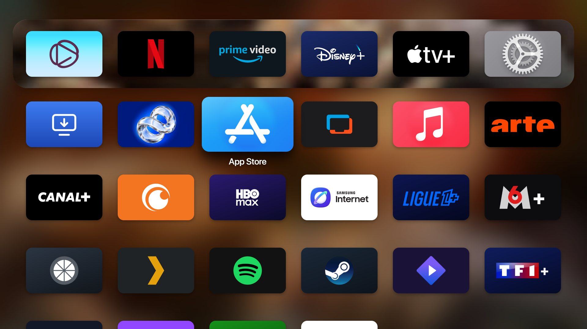
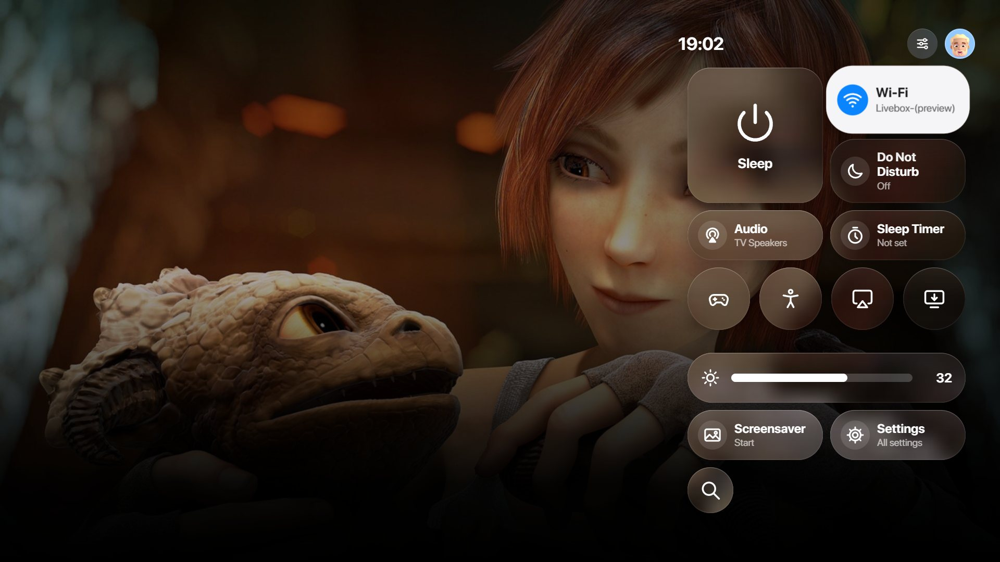
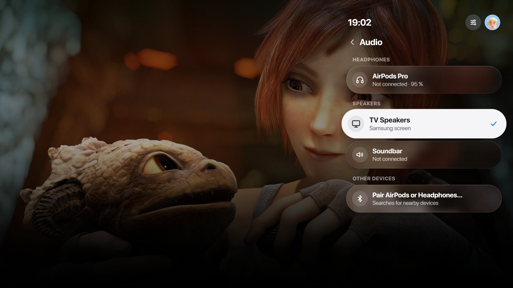
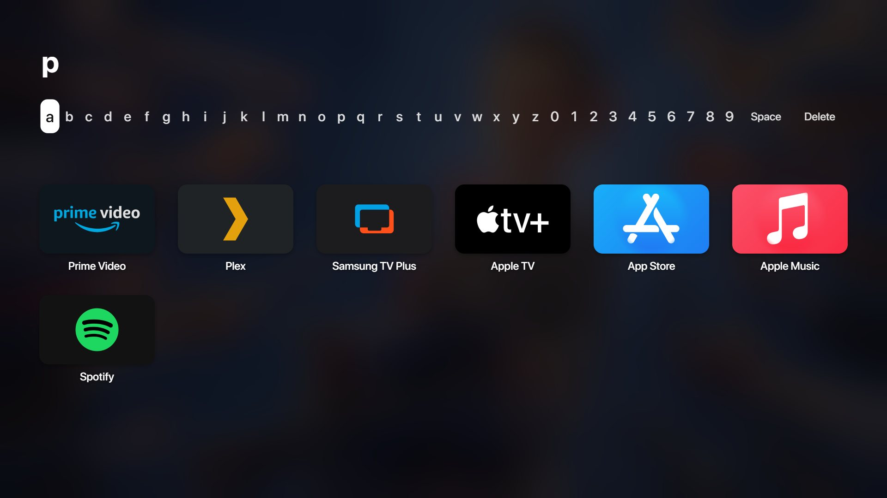
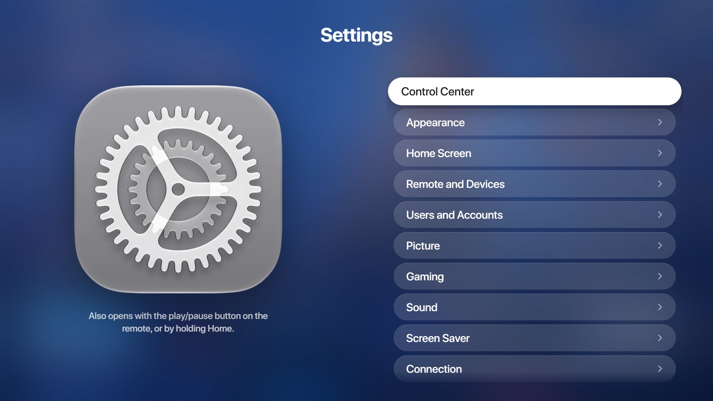
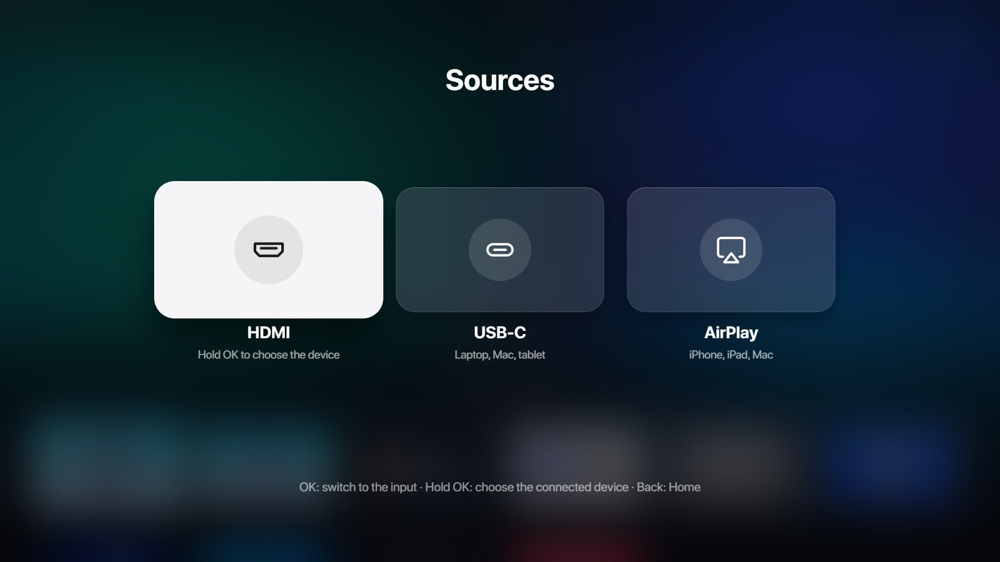
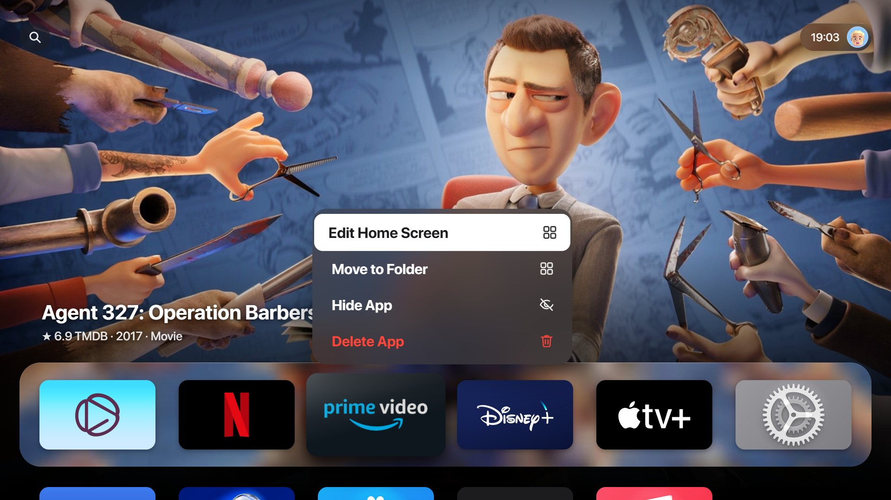
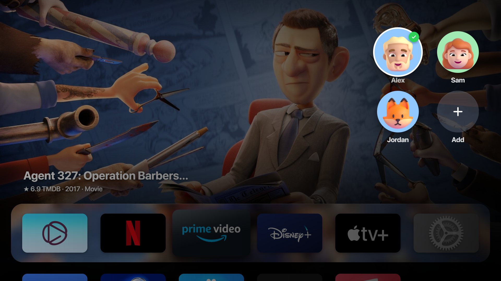

# APL Launcher for Tizen OS

**An Apple TV–style home screen for Samsung Tizen TVs and Smart Monitors.**
Top Shelf, glass dock, Control Center, Settings, Sources — and no more Samsung menus.

Created by Knikt (Gero Corp.)

**[▶ Try it in your browser](https://knikt.github.io/APL-Launcher-for-TizenOS/)** — no download, nothing touches your TV. Arrows, Enter and Esc (or the on-screen remote).

[Requirements](#requirements) · [Install](#quick-start) · [Features](#features) · [APL TV](#apl-tv) · [What's new](CHANGELOG.md) · [Compatibility](docs/compatibility.md) · [User guide](docs/user-guide.md) · [Troubleshooting](docs/troubleshooting.md) · [Français](README.fr.md)

---

## Features

- **tvOS home screen** — full-screen Top Shelf for the focused app, a glass dock, a grid of 5, 6 or 7 apps per row (*Settings › Home Screen › Apps per Row*), folders, the three tvOS states (Top Shelf, grid with a frozen blurred background, full screen), springy focus motion and interface sounds.
- **Liquid Glass** — the dock, the clock, the Control Center and Sources are made of glass that shows the picture behind them. The glass is made once for each picture instead of being blurred live, so it is always on and never slows the screen down. Each piece of glass darkens just enough for its text, so it stays readable on a white poster as well as on a dark one, in the dark and the light theme.
- **Search** — press ▲ twice from the dock and type a few letters: the matching apps show as you type, and before that the ones you used recently. Hidden apps too if you want (*Settings › Home Screen › Search Hidden Apps*).
- **Live Top Shelf** — what's trending right now in your country on Netflix, Prime Video, Disney+, CANAL+, Crunchyroll, JioHotstar, Sony LIV and other services, YouTube trends, Xbox Game Pass games, Steam top sellers, the next Ligue 1 and Champions League matches, Top albums for music apps, with film and series ratings. Apps that fill Samsung's home with your own rows come first: Plex's *Continue Watching*, Spotify's mixes. Other apps get soft sheets of light in their colours, never a plain logo, or, with *Dynamic Backdrops* (*Settings › Appearance*), a film or series that service streams right now.
- **Continue Watching** — for IPTV apps (AquaPlay, Hot Player, [APL TV](#apl-tv)), Stremio and Nuvio: the last channel with its logo, or the film or series you were watching, with its title artwork, episode, time left and progress bar.
- **Official logos for 50+ apps**, and for any other app the launcher finds its official icon and an Apple TV background by itself.
- **Control Center** (tvOS 26/27 layout), even over a video — Sleep, Wi-Fi, Do Not Disturb, sleep timer, brightness, **audio output with Bluetooth headphones** (AirPods…, with battery), Game Mode, accessibility, AirPlay and iPhone help, Sources, screen saver, Settings and Search. Moving around it is smooth: 53 to 56 frames a second on the M8.
- **Settings** — an Apple TV–style split view that covers every Samsung settings page, with real picture controls (backlight, contrast, sharpness, colour, local dimming).
- **Sources** — every HDMI input of the screen, USB-C and AirPlay as big tiles, and on TVs **Live TV** (antenna, cable or satellite). Pick the device on each input (Switch 2, Steam Deck, PS5, Xbox, PC, Mac, Apple TV…) and it shows its logo. Hold OK on an input to put it on the Home Screen like an app.
- **Remote buttons** — press Home twice for the app switcher, hold Home or press ⏯ for the Control Center (or Play and Pause in apps, as you like). When they are installed, Samsung TV Plus opens AquaPlay and Prime Video opens TizenTube. *Settings › Remote and Devices › Set Up the Remote Buttons* sets all this in Vetro from the screen, no PC needed.
- **Alexa on the microphone button**, with a Siri-like glow at the bottom of the screen while you speak.
- **Hold OK on an app** — Edit Home Screen (move apps), Move to Folder, Hide App, Delete App, exactly like tvOS.
- **Household profiles** next to the clock, with **Memoji** avatars — each person has their own home layout, hidden apps, preferences and recently opened apps.
- **Aerial screen saver** with Apple's real aerial videos, in 4K, or a clock. Against burn-in, the clock can move from corner to corner (*Settings › Screen Saver › Move the Clock*): the launcher recognizes OLED screens by their model and turns it on there by itself.
- **Starts in a second** — *Settings › General & Privacy › Start on APL Launcher* makes the launcher the screen's home app: it shows about a second after power-on instead of about a minute (1.3 s instead of 64 s on the M8), and waking the screen goes back to the app you were watching.
- **Keeps the screen fast** — apps left in the background for 10 minutes close by themselves (never the one you are watching), and the ones Samsung opens on its own close after 1 minute if you never used them. The launcher itself stays in memory: leaving an app never shows a black screen while it starts again.
- **Automatic updates** from this repository, with automatic rollback if a version fails to start.
- **Optimizer** — removes unused apps, silences ads, tracking and Bixby, blocks ad domains; fully reversible.
- **English and French** — the interface follows the screen's language, or *Settings › General & Privacy › Language*.
- **APL Launcher Setup** — one Windows app to install, optimize and restore everything. No Windows PC? Install from a phone with Apps2Samsung, or from macOS or Linux with a Python script.

Nothing else is installed: the installer puts APL Launcher and its small helper app, APL Overlay, on the screen, and that is all.

| | | |
|---|---|---|
|  |  |  |
|  |  |  |
|  |  | |

## APL TV

**[APL TV](https://github.com/Knikt/APL-TV)** is the IPTV player made to go with APL Launcher, by the same maker: Live TV, movies and series from your own M3U playlists and Xtream accounts, and from your own Jellyfin, Emby or Plex server, in the same Apple TV style. It runs on Samsung (Tizen 6 or newer), LG (webOS) and Android TV, Google TV and Fire TV.

- **Live TV** with the channel playing behind the interface, a **TV guide** grid, **Multiview** on Samsung (up to 4 channels at once), and a live channel you can pause and go back in.
- **Movies and series** with their plot in your language, cast, IMDb ratings, seasons and episodes, and age ratings in your country's own scale.
- **Your own media server:** Jellyfin, Emby and Plex, one category per library, played straight from the server.
- **Continue Watching**, favourite channels, **search** by keyboard or with **Alexa**, and setup from your phone with a QR code, where you can also sort your playlist.
- **Made for APL Launcher:** on the Home Screen, APL TV's Top Shelf shows what you were watching and your last channel, and OK opens it right there.
- **Install** it with APL Launcher Setup (*Install* page › *Also install APL TV*) or from its [releases](https://github.com/Knikt/APL-TV/releases/latest): a `.wgt` for Samsung, an `.ipk` for LG, an `.apk` for Android. No root needed.

APL TV is only a player: it comes with no channels, no playlists and no provider. Use it with content you have the right to watch.

## Requirements

What works on which screen and remote: [docs/compatibility.md](docs/compatibility.md).

| | |
|---|---|
| **Screen** | A Samsung TV or Smart Monitor running Tizen 7 or newer (developed on a Smart Monitor M8, Tizen 9). On Tizen 6 the launcher works on its own, without APL Overlay: no Control Center over apps, no Alexa, no closing of idle apps. Tizen 5.5 and older: not for now. |
| **Vetro** *(required)* | [Vetro](https://github.com/andrearicci93/vetro) must be installed and running on the screen, **before** you install APL Launcher. Vetro gives root access through a small service on the screen; APL Launcher uses it for the Home button and the other remote buttons, the Control Center over videos, real picture settings, Bluetooth audio, Alexa, closing unused apps and the optimizer. Install it with **Vetro's own guide**: it needs the screen to be rooted. Its dashboard then answers at `http://<screen-ip>:8099` (if your Vetro uses another port, the launcher and APL Launcher Setup find it). Without Vetro, see the [FAQ](#faq). |
| **PC** | Windows 10 or 11 on the same network as the screen. No Windows PC: [Apps2Samsung](docs/installation.md#alternative-apps2samsung-or-tv-store) from a phone, or [`scripts/install-via-vetro.py`](docs/installation.md#no-windows-pc-install-through-vetro-with-python) with Python 3 from macOS or Linux. |
| **Tizen Studio** | With the CLI and the *Samsung Certificate Extension* — [download](https://developer.tizen.org/development/tizen-studio/download). |
| **Samsung certificate** | An author + distributor certificate for your screen (Tizen Studio Certificate Manager, or one made with Apps2Samsung). APL Launcher Setup finds it. Keep it safe: every later install must be signed with the same certificate, or the screen refuses it. |

TizenBrew and TizenTube are **not** needed. If you use them, the launcher opens them and leaves them alone.

## Quick start

1. **Install Vetro** on the screen, following Vetro's guide, and check that `http://<screen-ip>:8099` opens on the PC.
2. **Download APL Launcher Setup** (`APL-Launcher-Setup.exe`) from the [latest release](https://github.com/Knikt/APL-Launcher-for-TizenOS/releases/latest) and open it. Windows may say the app is not signed: *More info › Run anyway*.
3. On the **Install** page, the app finds the screen (or type its IP address), checks Tizen Studio, the Samsung certificate on the PC, and takes the optional API keys (TMDB, YouTube, Fanart.tv) and websites to show as apps. Click **Install**: it builds, signs and installs the launcher and APL Overlay through Vetro, then opens the launcher.
4. Finish once, as the app shows you:
   - on the screen: *Settings › All Settings › Advanced Features* → **Autorun Smart Hub** off, **Autorun Last App** on;
   - in Vetro › **Remapper**: choose your remote in the device list (*Smart Control 2016* when it is paired over Bluetooth, *wt61p807 rc device* when it works by infrared only), map **Home** to **APL Launcher** and turn on **Remote interception**. Then click **Done — set up the buttons** in the app: it hands Home and ⏯ to APL Overlay, and Samsung TV Plus or Prime Video too when AquaPlay or TizenTube is installed. On the screen, *Settings › Remote and Devices › Set Up the Remote Buttons* does the same.
5. *Optional:* the **Optimize** page removes unused apps and services. It reads the screen, shows the full list and waits for your confirmation.
6. *Optional:* for Alexa, open *Settings › Remote and Devices › Alexa on the Microphone Button* in the launcher, choose Amazon Alexa and sign in with your Amazon account. The remote must be paired over Bluetooth: point it at the screen and hold **Back** and **⏯** together for 3 seconds. Then pick *Smart Control 2016* in Vetro's device list.
7. *Optional:* *Settings › General & Privacy › Start on APL Launcher* makes the screen start on the launcher in about a second.

**Something wrong?** The **Restore** page gives the Home button back to Samsung and undoes the optimizer.

**No Windows PC?** Install from a phone with Apps2Samsung, or from macOS or Linux with `scripts/install-via-vetro.py`: both are in the full guide.

Full guide: [docs/installation.md](docs/installation.md).

## Updates

The launcher **updates itself**. Every 6 hours it checks this repository, downloads the new version and restarts when you are on the home screen. If a new version fails to start, the screen goes back to the installed one on its own.

Open APL Launcher Setup again only when the screen asks for it, which happens when a new version needs new app permissions, and to update APL Overlay.

What changed in each version: [CHANGELOG.md](CHANGELOG.md).

## APL Launcher Setup

One Windows app, in English, or in French when Windows is. Nothing to install to run it (it uses the .NET Framework built into Windows 10 and 11).

| Page | What it does |
|---|---|
| **Install** | Finds the screen, checks the PC, builds, signs and installs the launcher and APL Overlay, then guides you through the last two settings. Optionally installs [APL TV](https://github.com/Knikt/APL-TV) too, the IPTV player in the same style for your own playlists. |
| **Optimize** | Removes unused apps, silences ads, tracking and Bixby, blocks ad domains. Shows everything first; reversible. |
| **Restore** | Gives the Home button back to Samsung and undoes the optimizer; can also uninstall the launcher. |
| **Tools** | Preview the launcher on the PC with an on-screen remote, repair TizenBrew and TizenTube, read-only diagnostics of the inputs and of the screen, open Vetro. |

The app runs the PowerShell scripts in `scripts/`, which also work on their own. To build it yourself: [installer/README.md](installer/README.md).

## Documentation

- [Installation](docs/installation.md)
- [Compatibility](docs/compatibility.md): screens, remotes, and what works today
- [User guide](docs/user-guide.md): remote, home screen, app menu, Control Center, Settings, Sources
- [Optimizer](docs/optimizer.md): what it removes, the DNS blocklist, how to undo it
- [Visuals and APIs](docs/visuals-and-apis.md): logos, live Top Shelf, API keys, personal websites
- [Development](docs/development.md): architecture, preview, releases, art pipeline
- [Testing on a real screen](docs/live-testing.md): Vetro API from a PC, quick deploys, logs, native control leads
- [Troubleshooting](docs/troubleshooting.md)

## FAQ

**Can the launcher itself be in 4K?** No. On these screens the layer that draws apps and menus has a single 1920×1080 mode, Samsung's own menus included, and the panel scales it up. Video has its own 4K layer: the aerial screen saver and the video apps use it.

**Can it install Android apps (APK)?** No. Tizen cannot run Android apps, and root access does not change that. Look for the app in the Samsung App Store, or add its website as an app.

**Does the Top Shelf show my personal recommendations?** For apps that publish rows to Samsung's home, yes: Plex shows your *Continue Watching* and recently added titles, Spotify your mixes and playlists (needs Vetro). Netflix, Crunchyroll and similar services have no public API for account data: for them, the launcher shows what is popular on each service in your country. *Continue Watching* cards exist only for apps that keep their history on the screen (AquaPlay, Hot Player, Stremio, Nuvio, APL TV).

**Does it work without Vetro?** Partly. Installed on a screen without root (from Apps2Samsung's TV-Store, for example), the launcher opens as an app, with its Top Shelf and Search. But Home opens Samsung's home, and the settings that need Vetro (picture, Game Mode, Start on APL Launcher, the remote buttons, Alexa, closing apps) say *Needs Vetro*.

**Is it OK on an OLED screen?** Yes. The launcher recognizes OLED screens by their model (S8x and S9x TVs, Odyssey OLED monitors with Smart TV), and there the screen saver's clock moves to the next corner every 2 minutes, a few pixels off each time, so no spot stays lit for hours.

**Is it safe?** Nothing in Samsung's system is deleted. Samsung's home is only closed in the background, and **Restore** in APL Launcher Setup undoes everything.

**Does it affect TizenBrew or TizenTube?** No. The launcher only opens them, and the optimizer always keeps them and TizenBrew's service. Samsung's own YouTube app (`9Ur5IzDKqV.TizenYouTube`) is not TizenTube; the optimizer can uninstall it on request. Keep Developer Mode's *Host PC IP* at `127.0.0.1`: TizenBrew and Vetro need it. If they stop working, run **Repair TizenBrew** in APL Launcher Setup › Tools.

**Which language?** English, and French: the launcher is in French when the screen is, the installer when Windows is. *Settings › General & Privacy › Language* picks one. To add a language, copy `launcher/js/lang-fr.js` and translate it.

## Contributing

Issues and pull requests are welcome. See [CONTRIBUTING.md](CONTRIBUTING.md).

Thanks to everyone who already sent pull requests: skjnldsv, exzos28, praneetchoudhary0-droid and BPHvZ. What each one brought is in the [changelog](CHANGELOG.md).

## Support APL Launcher

APL Launcher is free, open source and made by one person in my spare time. If you like it and want to help, you can buy me a coffee on [Ko-fi](https://ko-fi.com/knikt). It's never required and everything stays free. The same page supports [APL TV](https://github.com/Knikt/APL-TV) too.

## License and trademarks

The source code is released under the [MIT License](LICENSE).

APL Launcher is an independent project. It is not affiliated with, endorsed by or sponsored by Apple, Samsung or Amazon. Apple, Apple TV, tvOS, AirPlay, AirPods, Siri and Memoji are trademarks of Apple Inc. Samsung, Tizen and Smart Hub are trademarks of their owners. Amazon and Alexa are trademarks of Amazon.com, Inc. App, service and device logos belong to their owners and are shown only to identify them.

## Credits

APL Launcher is created by Knikt (Gero Corp.).

Vetro by andrearicci93 · TizenBrew and TizenTube by reisxd · icons from [dashboard-icons](https://github.com/homarr-labs/dashboard-icons), [Simple Icons](https://simpleicons.org), [selfh.st/icons](https://github.com/selfhst/icons) and [tv-logos](https://github.com/tv-logo/tv-logos) · aerial video list from [OrangeJedi/Aerial](https://github.com/OrangeJedi/Aerial) · film and series data from [TMDB](https://www.themoviedb.org) (*this product uses the TMDB API but is not endorsed or certified by TMDB*) and ratings from Stremio's public Cinemeta service · what each service streams now, for *Dynamic Backdrops*, from [JustWatch](https://www.justwatch.com) · artwork from [Fanart.tv](https://fanart.tv) · sports data from [TheSportsDB](https://www.thesportsdb.com) · 3D avatars from [Fluent Emoji](https://github.com/microsoft/fluentui-emoji) (MIT) · Memoji downloaded at install time from [wimell/tapback-memojis](https://github.com/wimell/tapback-memojis) (not included in this repository).
